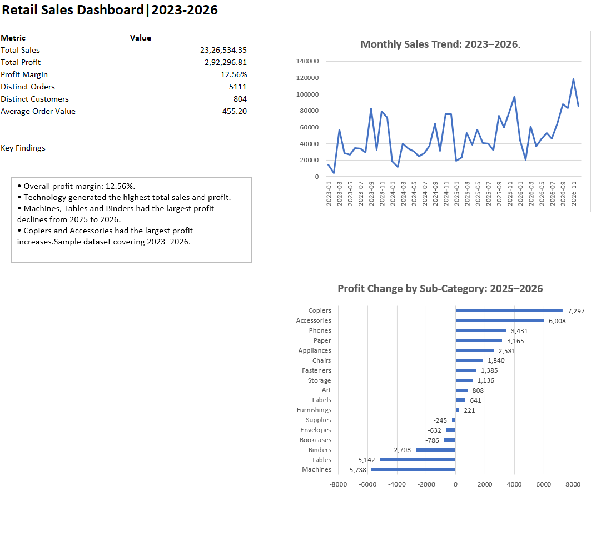

# Retail Sales and Profitability Analysis

A retail analytics project using Python, pandas, SQLite and Excel to explore sales trends, profitability and discount patterns in a sample Superstore dataset.

## Business Questions

- Which categories generate the most sales and profit?
- Which sub-categories and products are loss-making?
- How do sales and profit change over time?
- How are discounts associated with profitability?

## Dataset

- 10,194 product-line records
- 5,111 distinct orders
- 804 distinct customers
- United States and Canada
- Order dates from January 2023 to December 2026

This is a sample dataset, including future-dated records at the time of analysis. Results describe the dataset rather than verified real-world business performance. Currency is not confirmed, so amounts are presented without currency symbols.

## Tools

- Python: data preparation and analysis
- pandas: validation, aggregation and CSV exports
- SQLite: SQL analysis
- Excel: dashboard and charts

## Data Preparation

Checked for:
- Missing and blank values
- Exact duplicate rows and repeated Row IDs
- Shipping dates before order dates
- Non-positive sales and quantities
- Discounts outside the 0–1 range

No violations were found in these checks.

Trimmed surrounding spaces from text, stored postal codes as text and padded US ZIP codes to five digits.

Added:
- Order Year
- Order Month
- Shipping Days
- Profit Margin (%)

Negative profit values were retained because they represent losses.

## Key Metrics

| Metric | Value |
|---|---:|
| Total Sales | 2,326,534.35 |
| Total Profit | 292,296.81 |
| Profit Margin | 12.56% |
| Distinct Orders | 5,111 |
| Distinct Customers | 804 |
| Units Sold | 38,654 |
| Average Order Value | 455.20 |

Profit margin = total profit / total sales × 100.

Average order value = total sales / distinct orders.

## Main Findings

1. Technology generated the highest total sales and profit.
2. Furniture generated 754,747.76 in sales but had a margin of only 2.61%.
3. Tables, Bookcases and Supplies were loss-making across the full dataset.
4. Machines, Tables and Binders had the largest declines in profit from 2025 to 2026.
5. Copiers and Accessories had the largest increases in profit over that period.
6. September, November and December showed recurring periods of relatively strong sales.
7. A Lexmark printer transaction at 70% discount lost 3,399.98, while another transaction for the same product at 10% discount earned 680.00.

Discount findings show associations, not proof that discounts alone caused losses.

## Recommendations

- Review product-level profitability and discount practices for Tables, Machines and Binders.
- Investigate high-loss transactions before changing pricing policies.
- Monitor profit margin alongside sales growth.
- Validate costs and demand before setting discount limits or discontinuing products.

## Project Files

| File or folder | Purpose |
|---|---|
| prepare_data.py | Loads, validates and prepares the Excel data |
| analyze_sales.py | Generates sales and profitability reports |
| load_database.py | Loads the prepared CSV into SQLite |
| sql_analysis.py | Executes the saved transaction query and exports results |
| sql/high_loss_product_transactions.sql | Parameterized query for two selected products |
| data/processed/orders_cleaned.csv | Prepared dataset |
| data/retail_sales.db | SQLite database |
| reports/ | Exported summaries and Excel dashboard |

## How to Run

Place the source workbook at:

`data/sample_-_superstore.xls`

Install the dependencies in your Python environment:

```powershell
python -m pip install pandas xlrd
```

Run the scripts in order:

```powershell
python prepare_data.py
python analyze_sales.py
python load_database.py
python sql_analysis.py
```

Use the Python interpreter from your project environment.

Running `load_database.py` replaces the database's `orders` table with the current prepared dataset.

## Excel Dashboard

The dashboard includes:
- Overall business metrics
- Monthly sales trend
- Sub-category profit changes from 2025 to 2026

Open `reports/retail_sales_dashboard.xlsx` to view it.

The dashboard uses manually copied data and fixed summary values. Rerunning Python does not automatically refresh the workbook.

## Dashboard Preview



## Validation and Limitations

- SQL overall totals and category results matched the Python analysis.
- Repeated Order IDs can represent different products within one order.
- Category order counts are not additive because an order can contain multiple categories.
- Findings are descriptive and do not establish causation.
- The source download URL and dataset license still need to be documented before redistributing the raw data.

## Pipeline Automation

Run all four processing scripts with:

python run_pipeline.py

The pipeline stops if a script fails. Data preparation checks for
missing values, blank text, duplicate Row IDs, invalid shipping dates,
non-positive sales or quantities, fractional quantities and invalid discounts.

CSV reports are regenerated automatically. The Excel dashboard still
requires a manual update. Existing outputs may remain after a failed run.